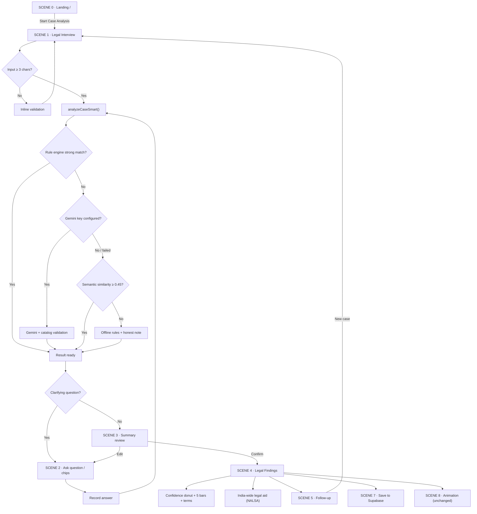
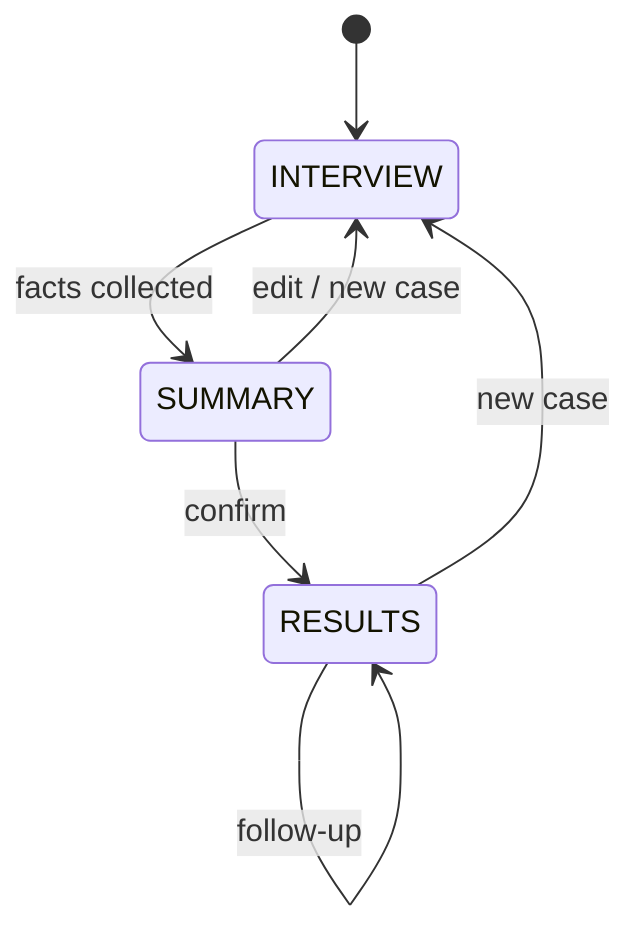

# Margavidi → Reference UI Redesign Plan

**Reference images:** `C:\Users\aarav\Downloads\major 1.jpeg`, `C:\Users\aarav\Downloads\major 2.jpeg`
**Target:** Match the reference colour, layout, interview pattern and analysis output.
**Constraint:** The existing animated scene (`src/lib/scene.ts` + `src/components/CaseSceneAnimation.tsx`) is **untouched** and stays as an optional extra.
**Status:** Main `/analyze` flow implemented. Supabase saving remains UI-only until credentials are provided.

---

## 1. Reference breakdown

### 1.1 Colour palette

| Token | Reference colour | Hex | Use |
|---|---|---|---|
| App background | near-black navy | `#05080F` | page |
| Panel | dark navy | `#0A111E` | left/right panels |
| Card | lifted navy | `#0D1626` | cards |
| Border | blue-slate | `#1B2A44` | dividers, chips |
| Cyan accent | electric cyan | `#22D3EE` | bars, links, active tabs, stage dot |
| Blue accent | royal blue | `#2563EB` | user bubbles, send button |
| Blue glow | soft blue | `#3B82F6` | focus rings, icon |
| Gold brand | muted gold | `#D4AF37` | brand name only |
| Text | off-white | `#E5E7EB` | body |
| Muted text | blue-grey | `#8B9BB4` | timestamps, hints |
| Success | emerald | `#34D399` | verified / completed |
| Warning | amber | `#F59E0B` | evidence gap / uncertainty |
| Danger | red | `#EF4444` | high risk |

Glow: `0 0 24px rgba(34, 211, 238, 0.25)`.
Gradient for confidence bars: `linear-gradient(90deg, #06B6D4, #3B82F6)`.

### 1.2 Layout

```
┌──────────────────────────────── TOP BAR ────────────────────────────────┐
│ Brand · Case Analysis            STAGE: RESULTS          English · gear │
├──────────────────────────────┬──────────────────────────────────────────┤
│  LEGAL INTERVIEW (45%)       │  LEGAL FINDINGS (55%)                    │
│                              │  Extracted terms chips                   │
│  assistant message           │  Supabase save banner                    │
│            user bubble       │  Legal Findings                          │
│  assistant question          │  Analysis confidence (donut + bars)      │
│            user bubble       │  India-wide legal aid                    │
│                              │  Summary                                 │
│  …                           │  Uncertainty note                        │
│                              │  Section cards (5 verified provisions)   │
│                              │  [existing animation toggle — untouched] │
├──────────────────────────────┴──────────────────────────────────────────┤
│  Ask a follow-up question…                                   🎙  ➤      │
└──────────────────────────────────────────────────────────────────────────┘
```

- 100vh app shell, independent scrolling in each column.
- Left 45 %, right 55 % on desktop.
- Mobile: panels stack vertically, each with its own scroll region.
- Top bar 56 px; composer 64–72 px.

### 1.3 Right-panel stack (exact order from reference)

1. **Extracted terms (research aid)** — outlined chips (`MVA`, `road accident`, `injury`, `no FIR`, …).
2. **Save banner** — “Analysis is ready. Sign in to Supabase to save this case to the database.”
3. **Legal Findings** heading.
4. **Analysis confidence** card:
   - donut with average %
   - `Confidence` / `Uncertainty` toggle
   - per-section horizontal bars (Section 1–5)
   - caption “Confidence by identified legal section, on a 0–100 % scale”
5. **India-wide legal aid** card:
   - NALSA helpline `15100`
   - NALSA office `+91 11 2338 2778`
   - `nalsa-dla@nic.in`
   - “NALSA contact details / Legal aid and advocate FAQ”
   - sample lawyer contact row
   - “Search NALSA directory / Call 15100” links
6. **Summary** card.
7. **Uncertainty** note — e.g. “The AI explanation was not available within the legal-response time limit.”
8. **Section cards** — `Section 134 Motor Vehicles Act, 1988 — Duty of driver in case of accident and injury…` with confidence badge and expandable details. **Five visible by default; “Show all” appears when the engine returns more.**
9. **Animation slot** — existing `CaseSceneAnimation` remains exactly as-is, opt-in and below the cards.

### 1.4 Left-panel pattern

- Header: vertical cyan bar + **Legal Interview**.
- Assistant messages: plain text on panel, small blue bot avatar, timestamp.
- User messages: blue bubble aligned right, small avatar, timestamp.
- System notices: small cyan check line (“✓ Analysis complete! I found 5 verified legal provisions…”).
- Composer: “Ask a follow-up question…”, mic button, circular blue send button.
- Stage chip in top bar: `STAGE: INTERVIEW` → `STAGE: SUMMARY` → `STAGE: RESULTS`.

---

## 2. Scene flow — step by step

### SCENE 0 — Landing (`/`)
**Screen:** existing landing page, re-themed to reference palette.
**Action:** click **Start Case Analysis**.
**System:** navigate to `/analyze`.
**Exit:** editor opens Scene 1.

### SCENE 1 — Legal Interview start
**Screen**
- Top bar: brand, `Case Analysis`, `STAGE: INTERVIEW`, language, gear.
- Left: **Legal Interview** empty state, composer, mic.
- Right: **Legal Findings** empty skeleton; extracted terms empty.

**Action:** user types or speaks the case, presses send.
**System**
1. Reject input shorter than 3 characters with an inline message.
2. Reset conversation context, messages, cards, stage.
3. Call `analyzeCaseSmart(text, context)`.
4. Show user bubble + typing indicator.

**Exit:** first clarifying question **or** summary/results if no question is needed.

### SCENE 2 — Clarification interview loop
**Screen**
- Left: assistant question, option chips, user answer bubble, timestamps.
- Right: extracted term chips populate live; “Analysis in progress” skeleton; no final confidence yet.
- Progress hint: `Question 2 of up to 4`.

**Question order (MVA, matching reference)**
1. Have you filed a police complaint (FIR)?
2. Were there witnesses? Can you provide contact details or descriptions?
3. Do you have evidence — photos, videos, medical records, CCTV?
4. Was the vehicle insured? Have you contacted the insurance company?
5. Was anyone injured?
6. Did the driver stop or flee?
7. Was the driver drunk?
8. Did the driver have a valid licence?
9. Overspeeding / wrong side / vehicle type (only if still unknown).

Only the first four are normally asked (`MAX_CLARIFICATION_QUESTIONS = 4`); facts already mentioned in the case text are skipped. Other domains keep one question.

**Action:** chip, typed answer, voice, or **Skip — show best answer**.
**System:** store answer in `conversationContext`, re-run engine, ask next question or advance.
**Exit:** no questions left **or** skip **or** enough facts collected.

### SCENE 3 — Summary review (new stage)
**Screen**
- Left: “Perfect! I've gathered the necessary information. Here's a structured summary of your case. Please review it carefully — if anything needs adjustment, let me know before we finalize the legal analysis.”
- Right: **Summary** card (incident, injury, FIR, witnesses, evidence, insurance, vehicle) + **Confirm analysis** / **Edit details**.
- Stage: `SUMMARY`.

**Action:** confirm or edit.
**System:** confirm → reveal the final analysis and move to results; edit → focus composer, keep `SUMMARY`.
**Exit:** `RESULTS`.

### SCENE 4 — Legal Findings / results
**Screen**
- Left: “✓ Analysis complete! I found 5 verified legal provisions that apply to your case. Review them on the right side for detailed guidance.”
- Right: full stack from §1.3.
- Stage: `RESULTS`.

**System**
1. Show the top **5** ranked sections by default; keep the rest behind **Show all** when the engine returns more.
2. Average confidence = mean of the 5 visible section confidences.
3. Render confidence donut + 5 bars.
4. Extract research terms from domain + top keywords + query.
5. Render legal-aid card, summary, and an uncertainty note when the AI explanation timed out.
6. Keep the animation toggle at the bottom of the panel, unchanged.

**Exit:** follow-up, legal-aid link, save, or new case.

### SCENE 5 — Follow-up / refinement
**Screen:** user asks “What is the punishment?”, “Where do I file?”, “Can I settle?” or describes a new case.
**System**
- Punishment / filing / settlement → answer from the top section, no new analysis.
- New case → reset to Scene 1 (`INTERVIEW`).
**Exit:** results stay, or a new interview starts.

### SCENE 6 — Legal aid branch
**Screen:** NALSA card.
**Action:** click phone / email / directory / sample lawyer.
**System:** `tel:`, `mailto:`, external NALSA links; no app state change.

### SCENE 7 — Save to Supabase (optional / decision)
**Screen:** “Analysis is ready. Sign in to Supabase to save this case to the database.”
**Action:** sign in.
**System:** auth modal → insert case JSON (`facts`, answers, top sections, confidence, summary, created_at) → success toast.
**Exit:** saved state / dismissed.
**Note:** needs a Supabase project, URL + anon key, and a `cases` table. If credentials are not provided, render the banner as **UI-only** and keep the case local.

### SCENE 8 — Animation (unchanged)
**Screen:** “🎬 Show scene” toggle in the right panel.
**System:** existing `buildSceneScript()` + `CaseSceneAnimation` render exactly as today.
**Rule:** no edits to `src/lib/scene.ts`, `CaseSceneAnimation.tsx`, or their tests.

---

## 3. Flowchart



### Stage state machine



---

## 4. Work division

### Track A — Design system + shell
**Owner:** Dev 1
**Files:** `src/index.css`, `tailwind.config.ts`, new `src/components/analysis/AnalysisShell.tsx`, new `TopBar.tsx`, `CaseAnalysis` layout split.
**Deliverables**
- palette tokens, glow, typography
- 45 / 55 split, independent scroll, mobile tabs
- top bar with brand, breadcrumb, stage chip, language, settings
- empty/loading/error states

**Depends on:** none.

### Track B — Interview + state machine
**Owner:** Dev 2
**Files:** `src/components/ChatPanel.tsx`, `src/pages/CaseAnalysis.tsx`, new `useCaseInterview.ts`, new `InterviewProgress.tsx`, new `SummaryReview.tsx`.
**Deliverables**
- reference chat bubbles, avatars, timestamps
- stage state machine `INTERVIEW → SUMMARY → RESULTS`
- summary confirmation / edit
- follow-up and new-case reset
- composer, chips, voice (voice unchanged)

**Depends on:** Track A tokens; Track D answer shape.

### Track C — Legal Findings panel
**Owner:** Dev 1 + Dev 3
**Files:** `src/components/LegalOutputPanel.tsx`, `LegalResponseCard.tsx`, new `AnalysisConfidence.tsx`, `ExtractedTerms.tsx`, `LegalAidCard.tsx`, `CaseSummaryCard.tsx`, `UncertaintyNote.tsx`, `SaveCaseBanner.tsx`.
**Deliverables**
- extracted terms chips
- confidence donut + average + Confidence/Uncertainty tabs + 5 bars
- NALSA legal-aid card
- summary + uncertainty
- 5 verified section cards
- existing animation slot preserved

**Depends on:** Track A tokens; Track D data (`matches`, average, terms, uncertainty).

### Track D — Analysis logic + data
**Owner:** Dev 2 + Dev 3
**Files:** `src/lib/search.ts`, `src/lib/analyze.ts`, `src/lib/gemini.ts`, new `src/lib/terms.ts`, new `src/types/analysis.ts`, tests.
**Deliverables**
- new questions: `witnesses`, `evidence`
- MVA question priority matching reference
- fact extraction for FIR/witnesses/evidence/insurance
- summary builder extended
- research-term extraction
- average confidence + uncertainty reason
- fix `computeAnswerBoost` so “No” does not increase confidence
- top-5 selection for results

**Depends on:** none — can start day 1.

### Track E — Supabase save (optional)
**Owner:** Dev 3
**Files:** `src/lib/supabase.ts`, `AuthDialog.tsx`, `.env.example`, `supabase/schema.sql`.
**Deliverables**
- sign-in, insert case, success state
- local-only fallback when env vars are absent

**Depends on:** Track C banner; Supabase credentials.

### Track F — QA / visual verification
**Owner:** QA or rotating dev
**Deliverables**
- screenshots at 1280×720 and 1440×900
- mobile tabs
- tests for stage machine, summary, confidence, terms
- `npm test`, `typecheck`, `lint`, `build`
- animation tests unchanged and passing

---

## 5. Sequence and estimates

| Phase | Work | Duration |
|---|---|---|
| 0 | Lock tokens, split `CaseAnalysis` into shell + hook, shared types | 0.5 day |
| 1 | Track A shell + Track D logic in parallel | 1 day |
| 2 | Track B interview + Track C findings in parallel | 1.5 days |
| 3 | Integrate confidence, terms, summary, stage | 1 day |
| 4 | Supabase (optional) + polish | 1 day |
| 5 | QA, screenshots, tests, build | 0.5–1 day |

**One developer:** ~5–6 days.
**Two developers in parallel:** ~3–4 days.
**Three developers (A/B/C) + shared D:** ~3 days.

### File ownership to avoid conflicts
- Split `CaseAnalysis.tsx` first into `CaseAnalysisPage.tsx` (layout, Track A), `useCaseInterview.ts` (logic, Track B), and `analysis/` components (Track C).
- Shared types live only in `src/types/analysis.ts` (Track D).
- No two tracks edit the same file at the same time.
- Animation files are frozen; only the existing slot is referenced.

---

## 6. Definition of done

- [x] Reference palette applied through CSS variables only (no scattered hex values).
- [x] 45/55 split, top bar, stage chip, stacked mobile layout.
- [x] Chat matches reference: assistant text, blue user bubbles, timestamps, avatars, composer.
- [x] Interview asks FIR → witnesses → evidence → insurance in the reference order.
- [x] Summary review stage with confirm/edit.
- [x] Results show five verified provisions by default, with **Show all** when more are found.
- [x] Confidence card has donut, average %, Confidence/Uncertainty toggle and 5 bars.
- [x] Extracted terms chips, static NALSA legal-aid card, summary and uncertainty note.
- [x] Animation unchanged and still passing its 13 tests.
- [x] `npm test` (109 passing), `npm run typecheck`, `npm run lint` (0 errors), `npm run build` all pass.
- [ ] Visual check at 1280×720 and 1440×900.
- [ ] Supabase save remains UI-only until credentials are supplied.

---

## 7. Locked decisions

1. **Brand:** renamed to **Margavidi**.
2. **Supabase:** UI-only banner for now; the Sign in button explains that credentials are missing.
3. **Confidence visual:** both the donut and per-section bars, with Confidence/Uncertainty tabs.
4. **Section count:** 5 cards visible by default; **Show all** when the engine finds more (up to 6).
5. **Legal aid contacts:** static NALSA details from the screenshot (`15100`, `+91 11 2338 2778`, `nalsa-dla@nic.in`).
6. **Summary confirmation:** required before results; editing the summary re-runs the analysis.
7. **Fonts:** keep DM Sans for UI and Playfair for the gold brand wordmark.
